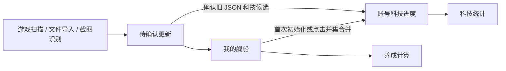

# 舰船数据模块重构计划

更新日期：2026-10-26。

状态：已实现，本文随当前规则更新。早期专项验证见 [验证记录](fleet-data-refactor-validation.md)；后续按用户要求修改功能而未重跑测试，历史验证结果不代表当前版本已通过全部检查。

基线：`test-runs/fleet-analysis-upstream-20261025/source` 中已同步用户本人 `deploy` 修复的实现，以及 `backend.tar` 提取的数据快照。此计划不以远端 `dev` 变动为依据。

现有实现说明见 [舰队数据分析](fleet-analysis.md)。该文档描述当前行为，本文描述重构目标，两者不能混同。

## 1. 重构目标

先重新定义数据含义，再拆分页面。仅整理组件不能消除业务状态层叠。

重构前主要问题：

- 当前拥有的舰船与账号累计取得的科技进度混杂；退役舰船不代表失去曾经解锁的科技。
- 扫描、数据维护、分析试算都有编辑入口，正式数据与临时结果的边界不直观。
- 科技页面提供数据、人工、合并等模式，使用户需要理解内部合并规则。

模块统一命名为「舰船数据」，设置四个平级页面，默认进入「我的舰船」：

| 页面 | 回答的问题 |
| --- | --- |
| 我的舰船 | 我目前有哪些船，它们是什么状态？ |
| 舰队科技 | 账号已经解锁哪些科技，还缺什么？ |
| 养成计算 | 把尚需培养的舰种练到120级，需要多少心智单元和物资？ |
| 扫描更新 | 怎样取得新数据，这次更新会改什么？ |

不增加单独的总览页，不再用一个巨大的分析页面嵌套多个完整页面。

四页视觉统一使用主程序的字体和主题变量，面板、按钮、输入框、圆角随全局主题变化；正文、筛选和表格13px，辅助说明12px，分区标题15px，汇总数值24px，页面主标题沿用全局样式。科技完成仍标绿、满级待觉醒仍标橙。样式统一不调整列表列项、筛选项、功能及独立滚动行为。

## 2. 基本原则

### 2.1 区分舰船种类和具体舰船

两艘企业在图鉴中是一种舰船，在「我的舰船」中是两条独立记录；科技奖励只计算一次，自动养成采用现有最高等级副本。

舰名不能充当唯一标识。改造形态、基础稀有度、科研分类由图鉴及明确规则关联，不依赖用户手动维护多个互相独立的字段。

### 2.2 正式业务数据只有两类

| 数据 | 含义 | 变化规律 |
| --- | --- | --- |
| 我的舰船 | 当前持有的每艘船及其等级、经验、突破等信息 | 可以新增、更新、退役 |
| 账号科技进度 | 每种舰船已解锁的获取、满星、120 级里程碑，以及阵营科技等级 | 正常情况下累计保留；错误可以明确纠正 |

静态图鉴提供名称、阵营、舰种、形态、费用和奖励规则，不是第三份账号记录。待确认更新是临时工作区，养成排除项是浏览器偏好，都不是另一份正式舰船数据。

### 2.3 扫描先确认，统计读取正式数据

扫描只提出更新，确认后才写入正式数据。未确认结果不直接用于统计，各分析页面不保留独立的最新扫描模式。

### 2.4 当前持有变化不抹掉累计科技

里程碑独立保存。首次建立数据可用正向事实初始化一次；之后修改或退役舰船不自动改变里程碑。用户点击「合并舰船数据」时，将数据正向事实并入已有进度，只增加完成记录，不删除历史完成记录。

错误通过科技表格直接修改，预览受影响的统计并统一保存。取消状态后，舰船变化、刷新或扫描均不会悄悄恢复它；仅用户显式点击合并时才补入数据正向事实。

### 2.5 未知与未完成、零值分开

- 经验未知不等于经验为 0。
- 科技里程碑仅记录已完成／未完成，未记录项目默认未完成；舰船数据的满星状态仍可未知。
- 本次没有扫到不等于已退役。
- 满星推断必须依据适用的舰船规则，不能对所有舰船统一套用等级阈值。
- 身份、等级或基础稀有度不确定时展示缺失原因，不计入资源合计；觉醒边界按固定规则计算。

### 2.6 正式统计只有一个口径

取消数据统计、人工统计、合并统计的业务模式切换。页面显示统一的费用口径和异常原因，科技表按各里程碑展示奖励；不保留逐副本历史证据或另一套正式状态。

计算规则集中维护，前后端遵循同一口径和数据版本，避免重复实现产生偏差。

### 2.7 常用操作直达，技术信息收起

默认页面不展示数据库序号、群组 ID、来源长字符串、原始稀有度等内部字段。舰船表格优先呈现玩家可以直接维护的信息。

页面通过「查看对应舰船」「查看养成计算」「处理待确认更新」直接关联。

## 3. 我的舰船

### 3.1 顶部摘要和操作

- 当前舰船数量，单位为「艘」。
- 不重复舰船种类数，单位为「种」。
- 需要核对的记录数。
- 最近一次确认更新时间。
- 主要操作：「保存」「添加舰船」「扫描更新」。

现有数据样本有 991 条舰船记录，必须区分具体舰船数与种类数。

### 3.2 主表

搜索、筛选和表格复用舰队科技的样式：蓝色分区标题、多选筛选按钮、搜索框与结果数量、蓝色可排序表头和隔行底色。全量表格不分页，表头固定，表格内部独立滚动。表格直接原地修改，顶部统一保存。第一列展示图鉴编号，默认按编号升序，同名副本及改造沿用所属舰船编号，无编号置后。编号、舰船、等级、突破状态、舰种、阵营、稀有度、核对状态均通过点击表头切换升降序，并显示方向；不再使用独立的“等级／舰名”排序下拉框。排序覆盖筛选后的全部记录，切换排序或筛选时表格返回顶部，未知值在两个方向均置后。阵营按图鉴顺序，稀有度按N→R→SR→SSR→UR，突破状态按未满星→已满星→未知；操作列和批量选择列不排序。

| 默认列 | 内容 |
| --- | --- |
| 编号 | 与舰队科技相同的图鉴编号，可升降序排列，未知显示—并始终置后 |
| 舰船 | 名称；同名副本显示副本标识 |
| 等级 | 当前等级 |
| 突破状态 | 未满星、已满星、未知，不保存具体突破次数 |
| 舰种 | 驱逐、轻巡等，随身份自动更新 |
| 阵营 | 所属阵营 |
| 稀有度 | 面向玩家的显示值 |
| 核对状态 | 正常、待核对、等级未知；额外经验未知不标记为信息缺失，满星未知由突破状态列单独显示 |
| 操作 | 删除／恢复；保存后生效 |

筛选分为类别、稀有度、阵营、完成情况、记录筛选及等级区间。完成情况仅保留未满级（已知等级低于120）、未满星、已满星和120级及以上；记录筛选提供需核对、重复舰船、等级未知和突破状态未知。同组多选取并集，不同组取交集；不提供科技获取状态、待觉醒手动标记或属性加成筛选。额外经验暂不展示。

### 3.3 原地编辑与统一保存

- 取消逐条查看／编辑入口及详情侧栏。
- 舰名、等级、突破状态、核对标记可直接在表格中修改。
- 图鉴匹配舰名后，自动更新身份、舰种、阵营和稀有度；未知身份保留待核对。
- 添加舰船生成表格顶部的新行；删除先标记待删除并可恢复。
- 顶部只有一个「保存」按钮，将所有行的修改、新增、删除及批量标记作为一个事务提交。
- 同名副本保持独立；科技和养成页的舰船链接定位并高亮对应行。
- 暂不显示额外经验，已有值保留。

### 3.4 编辑规则

- 排序及筛选保留修改；输入过程中维持原记录的位置。
- 草稿按实例保存在浏览器会话中，并记录编辑开始时的数据版本；后台更新不覆盖草稿，版本冲突禁止覆盖保存。
- 保存失败保留草稿；放弃草稿恢复正式数据。
- 删除在统一保存后生效，累计科技进度保留。
- 不参与某次养成计算属于计算范围，不作为舰船事实字段。
- 待确认差异不堆在主表下方，只提供「有 N 项更新待确认」入口。

## 4. 舰队科技

### 4.1 顶部摘要

- 已确认科技点数。
- 获取、满星、120 级各阶段的完成数量。
- 阵营科技等级概况。

科技全部完成必须有明确条件，不能仅以达到 120 级替代所有里程碑完成。

### 4.2 Wiki 科技列表主表

参照 [Wiki「舰队科技列表」](https://wiki.biligame.com/blhx/舰队科技#舰队科技列表)，有科技奖励的舰船一种一行，全量展示不分页，支持浏览器查找。

| 表头组 | 列 |
| --- | --- |
| 舰船信息 | 编号、名称、阵营／分组、舰种 |
| 科技点 | 获得、满星、Lv.120、合计 |
| 属性加成 | 解锁、120级 |
| 手动标记 | 满级待觉醒 |
| 养成效率 | 每千心智科技点 |

「满级待觉醒」由玩家自行点击设置，选中时仅该格高亮为橙色，提供同名筛选和排序。标记独立保存，默认未选中，不参与科技点、加成或完成判定，不与三个科技里程碑联动，也不随数据合并自动变更；统一保存。

所有数据列可点表头切换排序。科技点显示各阶段可得点数，同时以 ✓／— 表示已完成／未完成；获得、满星、120级的数字格分别随自身完成状态标绿；120级完成时编号、名称、阵营和舰种标绿，三个里程碑全部完成时合计格标绿。已解锁的属性单元格仍单独标绿。舰名链接进入我的舰船，当前数量和最高等级收在提示中，不占独立列。

### 4.3 筛选和属性加成

类别提供前排／后排及具体舰种，另有七档稀有度、阵营／分组、加成舰种、加成属性和完成情况。额外筛选可分别指定解锁与120级的舰种和属性。同组取并集，跨组取交集，舰种与属性必须匹配同一阶段。

属性区分别展示舰船科技贡献、阵营科技贡献和总加成，仅已完成里程碑计入舰船贡献；未填写阵营等级不计入阵营贡献。编辑草稿实时预览点数及加成。

### 4.4 独立维护与主动并集

本页维护独立科技里程碑和阵营等级，不修改舰船数据。打开记录编辑模式后，直接点击获得、满星、Lv.120或两列属性单元格切换状态，不弹出选择框；统一保存所有修改，不再逐舰打开纠错面板。

新库首次确认舰船数据时正向初始化一次；先编辑科技则不再自动初始化。JSON 导入时将旧记录转换为新版里程碑，日常读取不执行旧结构兼容。后续新增、修改、删除、扫描或导入舰船都不自动覆盖科技进度。手动科技编辑不再因舰船现状冲突而拒绝，点亮满星补记已获得，点亮120级补记已获得且常规舰船补记满星；获取与解锁共用状态，120级与120级加成共用状态。取消获取或解锁时清除满星和120级，常规舰船取消满星时同时清除120级，特殊舰船仅清除满星；取消120级保留获得和满星；保存三个最终状态，刷新不重新推导用户取消的记录。

提供「合并舰船数据」按钮：仅用户点击时，把已确认舰船的正向里程碑与旧里程碑作并集，已完成绝不降级，数据没有的项目不清除。并集检查科技与数据版本，有未保存草稿时先保存或放弃，无新增时不更新版本。

## 5. 养成计算

自动展示计算结果，不要求先选船，也不通过科技页按钮带入范围。

### 5.1 计算范围

- 每个有科技奖励的舰种，自动采用现有最高等级的一艘。
- 已完成累计120级科技的舰种不重复计算，退役不清除累计奖励。
- 最高等级已到120级的舰种不计费。
- 累计120级里程碑未完成的舰种按当前等级计算，不改写科技状态。
- 身份待核对和无科技奖励舰种不自动计入。
- 数据更新后自动重新选择最高等级副本并计算。

### 5.2 目标与条件

页面目标固定为120级，只按数据实际等级自动计算心智单元和物资。100、105、110、115级均视为尚未支付下一阶段觉醒费用，包含当前边界及后续阶段的剩余费用；超过边界后才视为已支付该阶段。无需填写假设等级或已觉醒上限，接口不接受试算参数。可选的排除勾选按舰种保存，「恢复全部参与」清空排除，不修改正式数据。页面不读取旧试算清单、URL 选择列表或舰船排除字段。

### 5.3 结果

摘要只展示心智单元、物资、参与计算数量和信息不足数量。

| 明细列 | 内容 |
| --- | --- |
| 参与计算 | 取消勾选可排除本舰种 |
| 舰船 | 当前最高等级的具体副本 |
| 当前等级 | 正式等级 |
| 心智单元 | 培养至120级的觉醒费用 |
| 物资 | 培养至120级的觉醒费用 |
| 每千心智科技点 | 120级奖励科技点 ÷ 100→120级完整心智单元费用 × 1000，越高越划算 |
| 满级待觉醒 | 共享舰队科技已保存的手动标记，选中标橙，在科技页修改 |

每千心智科技点按基础稀有度使用同一份觉醒费用规则，科研PR按SSR、DR按UR计费，分母固定包含100、105、110、115四次觉醒，不因当前等级、已付费用或手动排除而变化。数值乘以1000后固定保留两位小数，排序使用未舍入原值。舰船、当前等级、心智单元、物资、每千心智科技点五列可点表头切换升降序，默认每千心智科技点降序，缺失值始终置后。

费用汇总、搜索及明细使用与舰队科技一致的样式；明细内部独立滚动，不分页。仅异常行在舰名下显示缺失原因与数据核对链接，不再逐行展开说明或试算表单。不包含突破、强化和科研开发费用。经验原始数据保留，本轮不计算或展示经验需求。

提供舰队科技同款完整筛选表：类别、稀有度、阵营、加成舰种、加成属性，以及解锁和120级加成的额外筛选；组内取并集，跨组取交集。完成情况使用共享科技记录，仅保留未练满级、未满星和满级待觉醒；范围只包含当前持有舰船，省略未获得、已获得、未满级、Lv.120及冗余的未完成。「未练满级」在两页均表示Lv.120未完成且未标记满级待觉醒，不限制是否获得。搜索支持舰名、别名和编号。筛选仅控制明细显示，资源合计仍以全部参与舰船计算。舰队科技同时展示同一口径的每千心智科技点，支持两位小数及表头排序，首次点击降序。

## 6. 扫描更新

按三个顺序区域组织，避免嵌套标签。

### 6.1 开始读取

- 来源：游戏扫描、文件导入、截图识别。
- 游戏扫描范围：完整扫描、指定等级范围。
- 明确列出本次能够读取的字段。
- 开始、停止及必要设备状态。

旧 JSON 迁移放入「导入旧数据」折叠项，不长期占据所有页面顶部。

### 6.2 读取进度

- 当前阶段。
- 已识别数量。
- 身份不明或读数异常数量。
- 是否完整结束。
- 失败或停止原因。

读取完成与更新已保存必须是不同状态。

### 6.3 确认更新

摘要展示新增、变化、疑似缺失和需人工匹配的数量。

| 对象 | 当前记录 | 新读数 | 建议处理 |
| --- | --- | --- | --- |
| 某舰船 | Lv.100 | Lv.105 | 更新等级 |
| 某舰船 | 无对应记录 | Lv.1 | 新增 |
| 同名副本 | 多个可能对象 | Lv.120 | 选择对应副本 |
| 某舰船 | 当前存在 | 完整扫描未发现 | 核对是否移除 |

处理规则：

- 无歧义的新增、更新可批量确认。
- 同名副本必须明确对应关系。
- 移除建议单独确认，不混入全部接受。
- 局部扫描不能提出范围之外的删除建议；整体未满足完整性条件时不能据此删除。
- 未读取字段不覆盖已有值。
- 舰船差异确认不自动补充科技里程碑；如需更新，前往科技页显式合并数据。
- 新扫描不能悄悄替换尚未处理的结果。

第一版保留最近一次读取结果和简短操作摘要，不增加复杂历史批次浏览系统。

## 7. 移除的层叠与实现边界

| 原有设计 | 当前实现 |
| --- | --- |
| 公共扫描面板挂在所有分析页面上方 | 独立扫描更新页面 |
| 科技数据、人工、合并模式 | 一份正式科技进度，按需查看依据 |
| 心智页独立维护舰船列表及导入 | 读取我的舰船，仅维护计算排除偏好 |
| 多页面分别维护身份修正 | 跳转我的舰船对应行原地修改 |
| 默认表格展示来源和内部编号 | 按需提供 |
| 用等级切换模拟科技完成 | 直接维护真实里程碑 |
| 多套报告各自推导正式状态 | 集中业务规则，一致数据版本 |

后端边界为图鉴、当前舰船、科技进度、扫描更新和计算服务。继续使用 SQLite，不为了重构增加事件总线、通用证据平台或额外中间数据库。正常扫描只计算完整性及核对数量，旧历史格式仅在显式 JSON 导入时转换。

前端共用筛选行和选项定义，各页保留自己的筛选范围与匹配规则。舰船报告由入口统一获取，养成页复用；静态图鉴在首次加载或重连时获取。养成页面文案使用现有翻译机制。

## 8. 实施顺序

### 阶段一：确定数据模型和规则

- 明确当前持有、历史获取、满星、120 级、未知状态及副本身份的定义。
- 明确科技补充与纠错规则、冲突处理和统计分母。
- 明确扫描可读取字段及完整性判定。

### 阶段二：用 deploy 数据验证迁移

- 使用 backend 数据的独立副本，不修改原始归档或原始数据库。
- 保留 991 条舰船记录的独立身份及人工信息。
- 旧科技记录能够证明的进度继续保留，未知里程碑转换为未完成，身份不明的舰船保留待核对。
- 旧舰船排除标记不导入；当前养成排除偏好仅在浏览器按舰种保存。
- 迁移前后逐项对账，统计变化逐项说明原因，不为保持旧总数延续错误推断。

### 阶段三：重建我的舰船和扫描更新

- 打通唯一的正式数据维护流程。
- 完成舰船表格原地编辑和统一保存。
- 验证扫描确认、副本匹配、字段保留和版本冲突处理。

### 阶段四：重建科技统计和养成计算

- 接入正式数据及集中计算规则。
- 移除旧状态链和重复编辑逻辑。
- 删除旧页面路由、旧计算 API 和任务别名，仅保留显式 JSON 导入。
- 更新现有模块说明，使实施后的文档与实际行为一致。

## 9. 验收标准

- [x] 两艘同名船可独立编辑，科技只计算一次。
- [x] 退役最后一艘同名船，累计科技仍保留。
- [x] 局部或不完整扫描不会误删舰船。
- [x] 扫描取消或未确认，不改变正式统计。
- [x] 人工经验不会被扫描的未知值覆盖，未知与 0 保持区别。
- [x] 科技纠错不会在刷新后被另一层状态悄悄恢复。
- [x] 科技里程碑可以独立纠正，显式并集只增加完成状态。
- [x] 自动计算不修改真实舰船，副本去重及边界计费规则可见。
- [x] 当前持有与累计获取分别记录；科技里程碑只显示已完成／未完成，养成范围自动按当前持有筛选。
- [x] 每项统计可以解释对象、口径、依据和未知项。
- [x] 迁移保留副本及人工信息，数据差异可核对、可解释。

## 10. 已落实的规则与实现边界

- 满星：逐卡只保存未满星／已满星／未知。新增、修改、确认扫描或导入时强制写入：所有舰船已知等级低于70级为未满星，身份确认的常规舰船高于100级为已满星；科研、META、原生UR不套用高等级规则。70级和100级均不触发强制规则。其余保留已知状态，无依据为未知。现有数据已完成状态规范化，读取时不重复推算；当前未满星不抹除历史科技完成记录。
- JSON 导入：解析旧配置并转换为新版待确认数据；SQLite 仅使用当前结构，不保存旧科技表和人工等级格式，不自动升级旧 SQLite。当前 991 条实际舰船的 ID 和累计里程碑完整保留。
- 科技：保存独立的「满级待觉醒」布尔标记，默认未选中；保留一次性初始化标记，读取不重播；里程碑独立保存，数据变化不自动晋升。手动修改及主动并集使用事务与版本检查，并集只增加完成状态。
- 导入：JSON/CSV/XLSX 文件和 PNG/JPEG/WebP 截图进入同一待确认流程，不先合并同名副本。扫描未读到的经验、突破和形态不覆盖人工值。
- 方案：自动养成排除偏好按实例和舰种保存在浏览器 localStorage，不继承旧舰船排除字段；表格编辑草稿使用 sessionStorage 并保留原版本。
- 费用：页面目标固定120级，按静态图鉴基础稀有度计算心智单元和物资，暂不计算经验；100、105、110、115级均视为尚未支付下一阶段觉醒费用，无需手工填写条件。不含突破、强化和科研开发费用。
- 读取状态：展示调度状态及最近成功读取摘要；实时异常详细原因查看现有任务日志，不增加逐帧或复杂历史批次存储。
- 存储：每个实例使用一个 schema v11 SQLite 数据库，独立保存舰船、里程碑、阵营等级和待确认更新；不保存逐副本历史证据，保留可空经验字段。事务、版本检查和副本歧义确认继续保留。
- 兼容：仅保留旧 JSON → SQLite 的显式导入，原 JSON 不修改；旧页面路由、旧计算 API、任务别名及旧 SQLite 自动升级代码已删除。旧格式解析集中在导入模块，正常读取不做回退。

核心约束：以当前舰船和累计科技两种事实为中心，扫描统一进入确认流程，养成计算只消费事实与目标。
